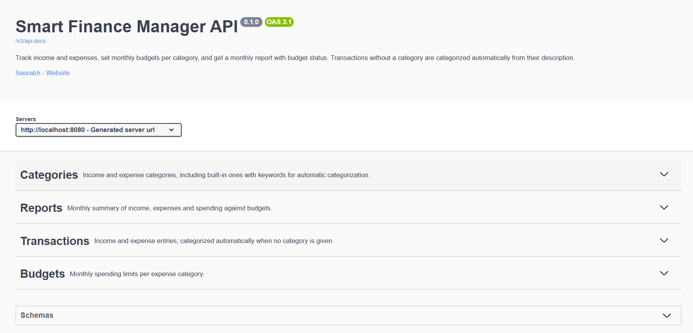

# Smart Finance Manager


A REST API for personal finance: track income and expenses, set monthly budgets per category, and get a monthly report showing where your money went. Transactions without a category are categorized automatically from their description. Every user has their own account, and all data is private to that user.

## Features

- **User accounts**: register and log in with email and password; passwords are hashed with BCrypt
- **JWT authentication**: login returns a signed token (HS256, valid for one hour) that is sent as a Bearer token with every request
- **Private data per user**: every category, transaction and budget belongs to one user; other users' data returns 404, as if it didn't exist
- **Transactions**: create, update, delete and list, filtered by month, date range or category
- **Automatic categorization**: "REWE Frankfurt Hbf" lands in Groceries by itself; the longest matching keyword wins, only the user's own categories are considered, and a category chosen by the user is never overridden
- **Default categories**: every new user gets their own starter set with German-relevant keywords, which they can rename, extend or delete
- **Monthly budgets**: one spending limit per expense category and month
- **Monthly report**: income, expenses, balance, and per category how much of the budget is used (OK, WARNING from 80%, OVER_LIMIT above 100%)
- **Consistent errors**: every error, including 401 Unauthorized, has the same JSON shape, with field-level messages for validation errors
- **Logging**: important events are logged by user id only, never passwords, tokens, emails or financial details
- **API documentation**: OpenAPI with Swagger UI, including an Authorize button for the token
- **Tests**: unit and controller tests, including ownership tests between two users, run on every push with GitHub Actions

## Tech Stack

- Java 21, Spring Boot 4
- Spring Web, Spring Data JPA (Hibernate), Bean Validation
- Spring Security, OAuth2 Resource Server (JWT)
- PostgreSQL 17
- springdoc-openapi (Swagger UI)
- JUnit 5, Mockito, MockMvc, Spring Security Test
- Docker, Docker Compose, GitHub Actions
- Maven, Lombok, SLF4J

## Quick Start

You only need [Docker Desktop](https://www.docker.com/products/docker-desktop/).

```bash
git clone https://github.com/spideytwenty99/smart-finance-manager.git
cd smart-finance-manager
cp .env.example .env        # on Windows PowerShell: copy .env.example .env
```

Open `.env` and set `JWT_SECRET` to a random Base64 key of at least 32 bytes. You can generate one with:

```bash
openssl rand -base64 32
```

or in PowerShell:

```powershell
$b = New-Object byte[] 32; [Security.Cryptography.RandomNumberGenerator]::Create().GetBytes($b); [Convert]::ToBase64String($b)
```

Then start everything:

```bash
docker compose up --build
```

Open Swagger UI at **http://localhost:8080/swagger-ui.html**.



## Trying It Out

**1. Register** with `POST /api/auth/register`:

```json
{
  "email": "alice@example.com",
  "password": "supersecret123"
}
```

The response contains a token:

```json
{
  "token": "eyJhbGciOiJIUzI1NiJ9...",
  "tokenType": "Bearer",
  "expiresIn": 3600
}
```

Your account starts with its own set of default categories. Later, use `POST /api/auth/login` with the same body to get a new token.

**2. Authorize.** Click **Authorize** at the top of Swagger UI and paste the token, without the word "Bearer". All following requests send it automatically.

**3. Create a transaction** with `POST /api/transactions`:

```json
{
  "amount": 12.50,
  "description": "REWE Frankfurt Hbf",
  "transactionDate": "2026-10-05",
  "transactionType": "EXPENSE"
}
```

The response shows the category Groceries with `"autoCategorized": true`.

Outside Swagger, send the token in the `Authorization` header:

```bash
curl http://localhost:8080/api/transactions \
  -H "Authorization: Bearer <your token>"
```

Requests without a valid token return `401` with the usual error format.

## Running the Tests

The tests include one that starts the whole application, so the database container needs to be running:

```bash
docker compose up -d db
./mvnw test
```

Set `DB_USERNAME`, `DB_PASSWORD` and `JWT_SECRET` to the values from your `.env` first. The same tests run automatically on GitHub for every push.

## Running from an IDE

Start only the database with `docker compose up -d db`, set the environment variables `DB_USERNAME`, `DB_PASSWORD` and `JWT_SECRET` to the values from `.env`, and run `SmartFinanceManagerApplication`. The database is reachable on port 5433, so it doesn't clash with a local PostgreSQL on 5432.

## Documentation

- [OpenAPI specification](docs/api/openapi.json): import it into Postman, or paste it into [editor.swagger.io](https://editor.swagger.io)
- [Requirements](docs/requirements.md)
- [Architecture](docs/architecture.md)
- [Database Design](docs/database-design.md)
- [API Design](docs/api-design.md)
- [Devlog](docs/devlog.md): what was built when, and the decisions behind it

## Project Structure

Organized by feature:

```
com.saurabh.financemanager
├── authentication  register, login, JWT creation, 401 handling
├── user            user accounts
├── category        categories, default categories per user, automatic categorization
├── transaction     transactions
├── budget          monthly budgets
├── report          monthly report
├── exception       error handling
└── config          security and OpenAPI configuration
```

## Next

- Machine learning for categorization, trained on corrected guesses
- An AI assistant that answers questions about your spending and budgets
- A small React frontend with a dashboard, transactions and budgets

## Author

Saurabh, Informatik student at Frankfurt University of Applied Sciences